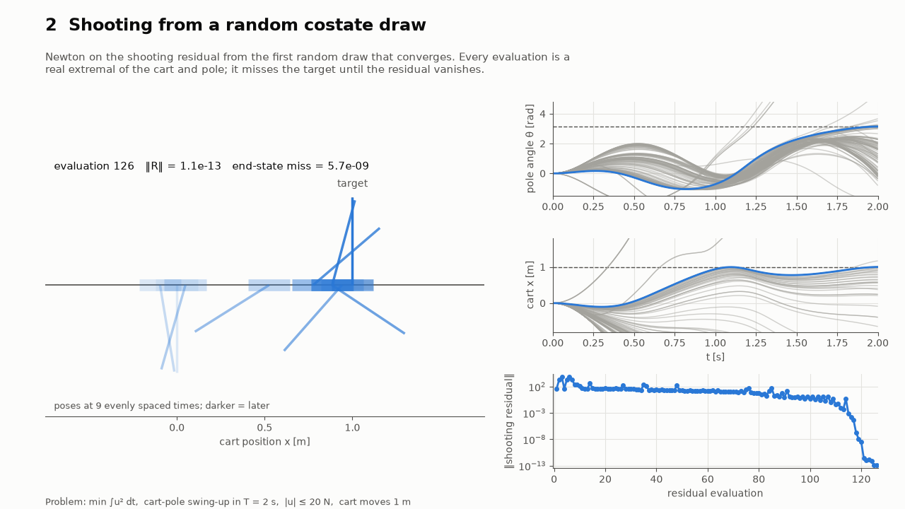
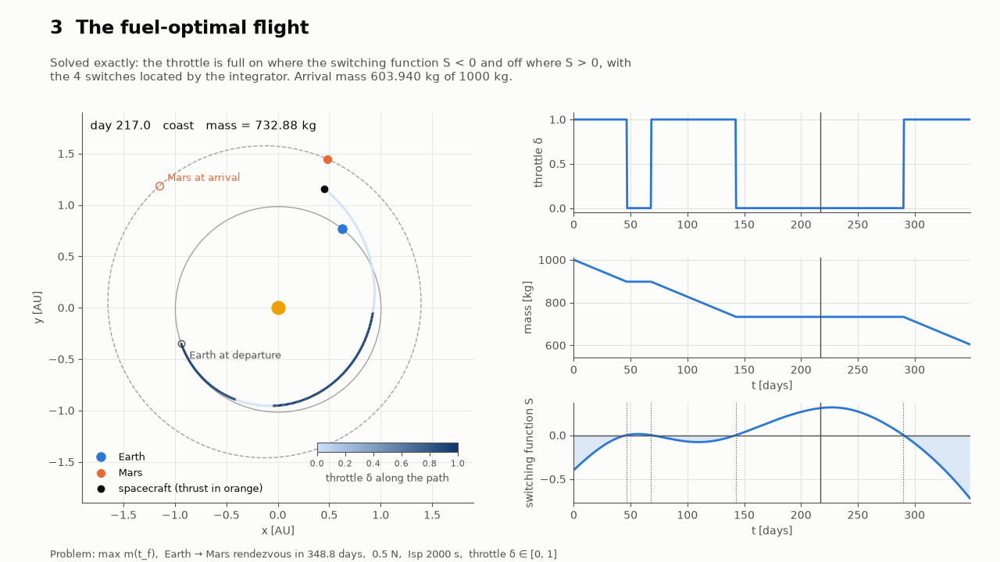
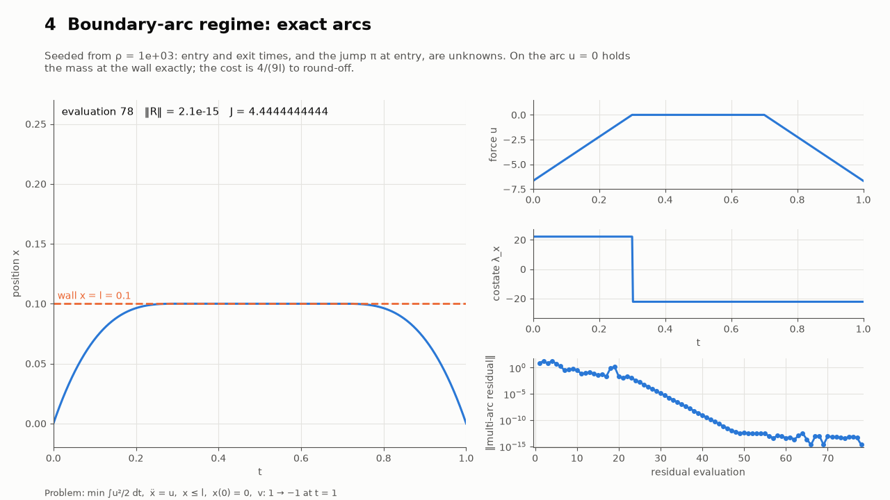
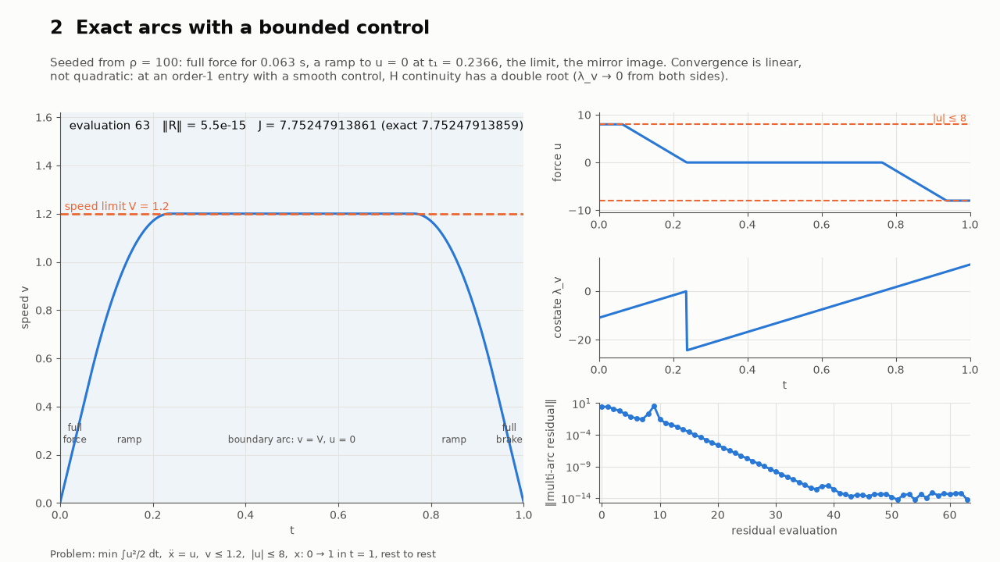
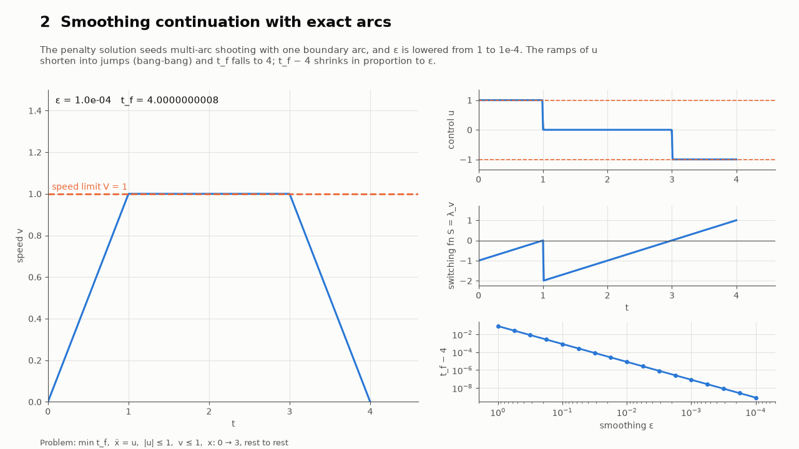
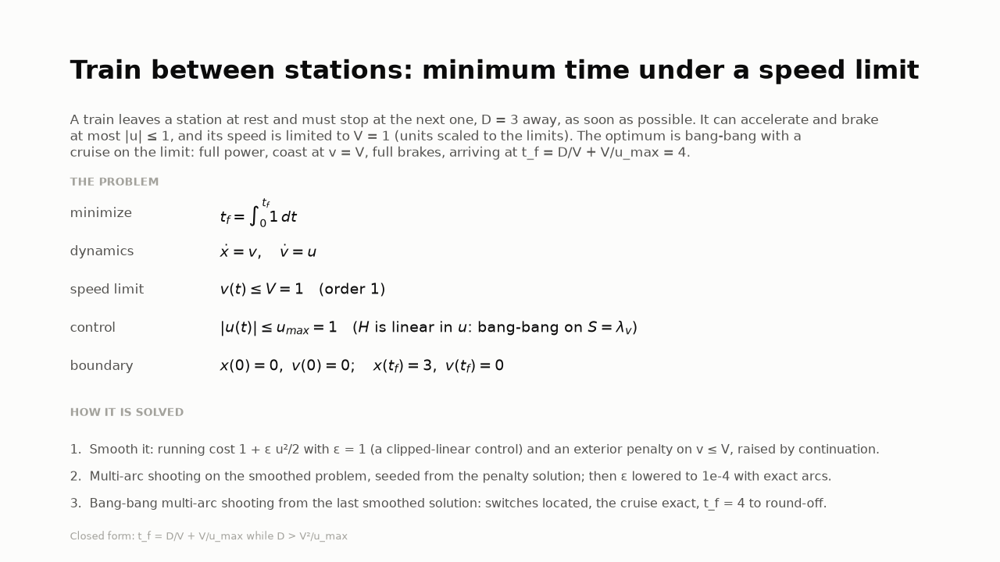

# auto-optimal-control

Express an optimal control problem symbolically and get every function the
indirect (costate) method needs to solve it as a two-point boundary value
problem: the Hamiltonian, the optimal control law, switching functions for
bang-bang controls, the state–costate dynamics and the boundary-condition
residuals.

**Documentation:** https://idm23.github.io/auto-optimal-control/, including a
lecture course on the indirect method built around one cart-pole.

Integration runs on
[fast-numerical-integration](https://github.com/idm23/fast-numerical-integration)
(FNI), which this package depends on from PyPI.

> **Status: pre-alpha.** Symbolic problem definition, Pontryagin derivation,
> generated and compiled C kernels, and arc-by-arc propagation of extremals
> with the state transition matrix are in place.

The core operation is the **forward map** from an initial costate to an
extremal: pick `lambda(t_0)` and get the optimal trajectory, its controls,
its cost, its switch times, its boundary residuals and, if you want them,
exact sensitivities. The package doesn't decide how `lambda(t_0)` is chosen.
Shooting, multiple shooting, continuation, or a learned sampler that proposes
costates can all be built on top of the same calls. One such layer ships with
the package, optionally: `auto_optimal_control.shooting`, a single-shooting
system with exact Jacobians and a solver.

## Installation

```bash
pip install "auto-optimal-control[shooting]"    # or: uv add "auto-optimal-control[shooting]"
```

The `shooting` extra adds SciPy, which `SingleShooting` and
`MultiArcShooting` use for their root finders. Leave it out if you only need
the derivation and the compiled kernels. The kernels are compiled when you
first build them, so you need a C compiler (`gcc` or `clang`). The
[fast-numerical-integration](https://github.com/idm23/fast-numerical-integration)
dependency installs as a pre-built wheel on Linux x86_64 and macOS arm64.

To work on the package itself:

```bash
git clone https://github.com/idm23/auto-optimal-control
cd auto-optimal-control
uv sync
uv run pytest                 # add --runslow for the literature benchmarks
```

## Example: minimum-time double integrator

```python
import sympy as sp
from auto_optimal_control.problem import Box, OptimalControlProblem
from auto_optimal_control.pontryagin import derive

t, x, v, u = sp.symbols("t x v u", real=True)
problem = OptimalControlProblem(
    time=t, states=[x, v], controls=[u],
    dynamics=[v, u], running_cost=1,                # minimum time
    initial_state=[1, 0], final_state={x: 0, v: 0},
    control_sets=[Box(u, -1, 1)])                   # |u| <= 1

pmp = derive(problem)
pmp.hamiltonian                  # Piecewise: 1 + lam_x v - |lam_v|
pmp.control_law[u]               # Piecewise((1, lam_v < 0), (-1, True))
pmp.switching_functions[0].expr  # lam_v
pmp.dynamics                     # (v, u*, 0, -lam_x) for z = [x, v, lam_x, lam_v]
pmp.boundary.residuals           # x(t_0) - 1, v(t_0), x(t_f), v(t_f), transversality, H(t_f)
pmp.boundary.unknowns            # x(t_0), v(t_0), lam_x(t_0), lam_v(t_0), nu_0, nu_1, t_f
```

Compile it and evaluate extremals from any initial costate:

```python
from auto_optimal_control.build import build_kernels

k = build_kernels(pmp)           # generate C, compile (cached), load
r = k.propagate(0.0, k.z0([1, 1]), 2.0, cost=True, stm=True)
r["switch_times"]                # [1.0]: u switches from -1 to +1
r["z"]                           # [x, v, lam_x, lam_v] at t = 2: x = v = 0
r["cost"]                        # 2.0 (minimum time)
r["stm"]                         # dz(2)/dz(0), including the jump at the switch
k.residual(k.z0([1, 1]), r["z"], r["z"][2:], 2.0)   # ~0 (nu = lam(t_f))
```

## Using the compiled kernels

`build_kernels(pmp)` prints the necessary conditions as plain C (see
`codegen.py` for the function list), wraps them for
[fast-numerical-integration](https://github.com/idm23/fast-numerical-integration)'s
GIL-free C API, compiles both and returns a `Kernels` object. Builds are
cached by a hash of the generated code and the toolchain. The first build
takes about 10 s and later ones load instantly, across processes too. The
cache is in `~/.cache/auto-optimal-control`, or `$AUTO_OPTIMAL_CONTROL_CACHE`
if set. Building needs a C compiler.

**The forward map (from an initial costate to an extremal):**

| Call | Returns |
|---|---|
| `k.propagate(t0, z0, t1, params, cost=, stm=, param_sensitivity=)` | final `z`, switch times, cost `J = int L`, and optionally `Phi = dz(t1)/dz(t0)`, `dz(t1)/dp` and `dz(t1)/dt1` |
| `k.propagate_batch(t0, Z0, t1, params, ..., n_threads=)` | the same for many rows at once, in parallel threads without the GIL; each row is bit-identical to `propagate` |
| `k.trajectory(t0, z0, t1, params, n_points=)` | sampled `t`, `z`, controls `u` and `H`, for plots and diagnostics |
| `k.z0(lam0, params)` | `[x0, lam0]` from the problem's fixed initial state |

Propagation runs **arc by arc**, as one FNI hybrid integration
(`fni_integrate_hybrid`, FNI >= 0.3). Each switching function is a guard,
located to round-off, and its reset map applies the saltation-matrix jump to
the STM and flips the arc. No integration step straddles the jump in the
control, and the step size carries across switches.

**Pointwise kernels:** `rhs`, `rhs_arc`, `jacobian` (`dF/dz`), `dfdp`,
`control`, `hamiltonian`, `cost_rate`, `switching`, `switching_gradient`,
`residual`, `residual_jacobian` (with respect to `z0`, `zf`, `nu`, `tf`, `p`)
and `stm_jump`.

**FNI objects:** `k.Dynamics(params)` and `k.ArcDynamics(params, arc, stm=)`
are native `OdeSystem`s, and `k.switching_events(params)` gives native
`EventFunction`s. They work with FNI's `solve_ivp`, `integrate` and
`integrate_batch`, and their `params` can be changed between solves without
recompiling.

**Plain C:** `k.write_c(directory)` writes the header and source on their
own; they depend only on `<math.h>`.

**Speed** (planar low-thrust example, 10 states, 3 switches, DOP853 at
`rtol=1e-10`):

| | time per extremal |
|---|---|
| NumPy reference (`NumericSystem` + FNI `solve_ivp`) | 67 ms |
| `k.propagate` | 0.05 ms |
| `k.propagate(..., stm=True)` (110 states) | 0.28 ms |
| `k.propagate_batch`, 1000 rows, 1 thread / 16 threads | 36 µs / 11 µs |

`auto_optimal_control.numeric.NumericSystem` is still there as a
pure-Python reference (lambdified with SymPy); the kernel tests compare
against it.

## Single shooting (optional)

`auto_optimal_control.shooting` turns the forward map into a square system
`R(v) = 0`. Nothing else in the package imports it. The unknowns `v` are
the free initial states, `lam0`, the terminal multipliers `nu`, and `t_f`
when it is free. The Jacobian is exact: the generated boundary Jacobians
chained with the STM, with the jumps at switches included.

```python
from auto_optimal_control.shooting import SingleShooting, continuation

shoot = SingleShooting(k, params)              # x0 defaults to the problem's
v = shoot.guess_multipliers(lam0, tf=2.0)      # least-squares nu for this lam0
R, dR = shoot.residual_jacobian(v)             # NumPy only: drive it with anything
sol = shoot.solve(v)                           # MINPACK hybr / lm, needs SciPy
sol.success, sol.lam0, sol.tf, sol.z0
```

- **`multistart(sample, n_tries)`** solves from random guesses until one
  converges.
- **`continuation(solve_at, start, values, v0)`** follows a homotopy
  parameter. It halves the step whenever a solve fails.
- **`trajectory(v)`** samples the extremal at `v`.

`solve` needs SciPy: `pip install auto-optimal-control[shooting]`. The
residual and Jacobian need only NumPy, so a sampler or any other solver can
use them directly.

## Defining a problem

`OptimalControlProblem` is in Bolza form:

```
minimize    phi(t_f, x(t_f)) + integral L(t, x, u) dt
subject to  x' = f(t, x, u),   x_i(t_0) fixed (or free),   psi(t_f, x(t_f)) = 0,   u in U
```

- **Parameters** (`params=[...]`) stay symbolic, so one derivation (and later
  one compiled kernel) serves a whole continuation sweep. Their order is the
  order of FNI's runtime parameter vector.
- **Final time** is free by default; pass `final_time=` to fix it.
- **Control sets:** controls are unconstrained unless placed in a set.
  - `Box(u, lower, upper)`: a Hamiltonian linear in `u` gives **bang-bang**
    control with a switching function; a convex quadratic one gives a
    **saturated** (clipped) control.
  - `UnitVector([u1, u2, ...])`: a direction such as a thrust direction or a
    heading. The optimum is `-b/||b||` (the primer vector for thrust).
- Declare positive quantities (masses, thrust, speeds) with `positive=True`.
  The derivation relies on it to simplify norms and to prove convexity.

## Path constraints

State limits `g(t, x, p) <= 0`, such as joint limits, a keep-out radius or a
speed limit, are declared on the problem:

```python
from auto_optimal_control.problem import PathConstraint

OptimalControlProblem(..., params=[ell, rho],
                      path_constraints=[PathConstraint(x - ell, "x_max", penalty=rho)])
```

- **Order.** `derive` differentiates `g` along the dynamics until a control
  appears. The number of derivatives is the constraint's *order*
  (`pmp.path_constraints[i].order`). A box on a control is order 0. A
  position limit on a double integrator is order 2. Order 3 or more warns:
  optimal solutions that ride such a limit generally chatter, with
  infinitely many touch points. A limit no control can reach raises an error.
- **Penalty.** With `penalty=w` (a parameter), `w/2 max(0, g)^2` is added to
  the running cost. Raise `w` by continuation
  (`shooting.parameter_continuation`) and the solution approaches the
  constrained one from below. Each constraint has its own flag in the arc
  (`N_MODES = N_SWITCHING + N_CONSTRAINTS` flags). Crossings of `g = 0` are
  located as events and switch the penalty on and off. The dynamics are
  continuous there, so the STM has no jump. Without a penalty, a constraint
  only monitors: crossings are reported and the extremal is unchanged.
- **Termination.** `propagate(..., terminate=True)` (or indices or names)
  stops at the first violation with status `-4`, and `t` is its time. It
  stops at `t0` if the start already violates. `propagate_batch`,
  `trajectory` and `SingleShooting(terminate=...)` take it too, and shooting
  then raises `ShootingError`. This is the death penalty for gradient-free
  search: any violating extremal is rejected outright. For a safety margin,
  put it in `g` as a parameter.
- **Results.** `propagate` returns `constraint_times` / `constraint_index`,
  `trajectory` returns `g` along the extremal, and `ShootingSolution` has
  `max_violation`.

**Detecting crossings inside a step.** An integrator that checks `g` only at
the ends of its steps misses a violation that starts and ends within one
step. Away from the limit the solution is smooth and steps are long, so this
happens easily. A missed crossing makes the residual run and the STM run
disagree about the dynamics, and Newton stalls. Two mechanisms prevent it:

```
 g   +           ╭──●──╮                ġ = 0 at the peak is an event: FNI splits
   0 ──────────┼─┼─────┼─┼──────        the step there, and g is monotone on each
     ●━━━━━━━━━╯         ╰━━━━━━●        side, so each side crosses zero at most once
     t_a        rise │ fall      t_b
```

- Every constraint gets a second event on `dg/dt`, the peaks and troughs of
  `g`. It has no reset map. FNI (0.4+) splits a step at every root it finds,
  so between consecutive peaks and troughs, `g` crosses zero at most once and
  the crossing is found.
- A peak and a trough can still fall in the same step. With the penalty off,
  the flow overshoots, then turns back. For that case, kernels with path
  constraints also use FNI's interior sign tests, at `n_interior` points per
  step (default 4). `n_interior=0` turns them off. They cost 3 extra RHS
  evaluations per step with DOP853.

The reset map sets each constraint's flag from the sign of `dg/dt` at the
crossing, so the flag always matches the side the flow moves to.

### Exact boundary arcs and touch points

The penalty solution only approaches the constrained optimum.
`MultiArcShooting` solves for it exactly, given the sequence of constrained
arcs:

```python
from auto_optimal_control.shooting import MultiArcShooting

# The penalty solution at rho supplies the structure's junction times and multipliers.
shoot, v0 = MultiArcShooting.from_penalty(k, [ell, 0.0], [("boundary", "x_max")],
                                          penalty_solution, [ell, rho])
sol = shoot.solve(v0)
shoot.unpack_arcs(sol.v)        # [(t_entry, t_exit, pi)]
shoot.cost(sol.v), shoot.diagnostics(sol.v), shoot.trajectory(sol.v)
```

- **Boundary arc** `("boundary", c)`, for order 1 or 2. Along it the control
  keeps `g^(q) = 0`. `derive` finds it, together with the multiplier `mu` of
  `H + mu g^(q)`, from `g^(q) = 0` and `dH/du + mu dg^(q)/du = 0`. The costates
  jump by `-dN/dx^T pi` at the entry, where `N = (g, ..., g^(q-1)) = 0`, and
  are continuous at the exit. `H` is continuous at both junctions (indirect
  adjoining; Bryson, Denham & Dreyfus 1963; Maurer 1977). Unknowns: entry,
  exit and `pi`.
- **Touch point** `("touch", c)`, for order 2: `g = g' = 0` at the contact,
  with `lambda+ = lambda- - nu dg/dx`. Unknowns: the time and `nu`.
- **Exact Jacobian.** The STM is chained across arcs, with the derivatives of
  each jump and of each junction time.
- **Checks.** `diagnostics` reports violations on the free arcs (a wrong
  structure shows up there), `nu` (it must be ≥ 0), `pi`, and the range of `mu`
  and of the controls on each boundary arc.
- **Seeding from a penalty solution.** `from_penalty` takes junction times
  from a penalty solution's crossings. A penalized boundary arc may dip back
  below the limit, so each arc spans its first to last crossing. It fits
  `pi` by integrating the boundary arc back from the exit.
- **Bounded controls.** `Box` controls keep their law on the free arcs:
  clipped where `H` is quadratic in them, bang-bang where it is linear, with
  every switch located as in single shooting. On a boundary arc the control
  is the one that rides the limit, and it must stay inside its bounds there:
  `diagnostics` reports `boundary_bound_violation`, and it counts toward
  `max_violation`. With bang-bang controls `solve` defaults to `"lm"`. The
  control jumps at the junctions, so `H` continuity reads `|S| = 0` there,
  which stalls the Broyden updates of `"hybr"`.
- **Seeding a bang-bang problem.** Its penalty solution is no use: the
  penalized optimum rides the limit on a singular arc. Smooth it instead.
  Add `eps u^2/2` to the running cost, solve that with exact arcs (from a
  penalty solution as above), and lower `eps` by `continuation`. The two
  problems have the same unknowns, so the last smoothed `v` seeds the
  bang-bang solve:

  ```python
  def smoothed(eps, guess):
      return MultiArcShooting(k_smooth, [V, D, u_max, eps, 0.0], arcs).solve(guess)

  path = continuation(smoothed, 1.0, np.logspace(0, -4, 17), v_smooth)
  sol = MultiArcShooting(k_bang, [V, D, u_max], arcs).solve(path[-1][1].v)
  ```

`velocity_limited_move` (order 1, with and without a force limit),
`bryson_denham` (order 2, both regimes) and `speed_limited_min_time`
(bang-bang) are solved against their closed forms.

### Singular arcs

Where a bang-bang control's switching function `S` vanishes on an interval,
the control is singular: `S = 0` says nothing about it, so `S` is
differentiated along the state–costate flow until the control appears.
`derive(problem, singular=True)` does this for each bang-bang control. `S'`
never involves the control; for an order-1 arc `S'' = a + b u` does, and
`S'' = 0` gives the singular control `u_s = -a/b`. Its arc kernels are
generated next to the boundary arcs': the dynamics at `u_s`, their Jacobian,
the Legendre–Clebsch coefficient `-dS''/du` (≥ 0 on a minimizing arc), and
the junction conditions `(S, S')` with their gradients.

`MultiArcShooting` takes singular arcs and switches in its structure:

```python
from auto_optimal_control.examples import GODDARD_PARAMS, goddard

k = build_kernels(derive(goddard(), singular=True))
shoot = MultiArcShooting(k, GODDARD_PARAMS, [("singular", "u", "upper", "lower")])
v = shoot.pack_arcs(shoot.pack([-2.5, -0.18, 0.005], [-0.03], 0.2), [(0.03, 0.1)])
sol = shoot.solve(v)            # h(t_f) = 1.01283692, t_f = 0.19885626
```

- **Singular arc** `("singular", u, before, after)`: unknowns are the entry
  and exit times, and the conditions are `S = S' = 0` at the entry. Along
  the arc `u_s` keeps `S'' = 0`, so `S` and `S'` stay at zero, and `H` is
  continuous at both junctions because `S = 0` there. The exit time is set
  by the conditions downstream.
- **Held bounds.** `before` and `after` name the bound (`"lower"` or
  `"upper"`) the control holds on the free arcs either side. A control with
  a singular arc holds its bound on every free arc, and its switches are
  `("switch", u)` entries (unknown: the time; condition: `S = 0`). Its
  switching function is not watched: at a singular junction it touches zero
  with `S' = 0`, where locating the root is ill-conditioned. `propagate`
  and `trajectory` take the held controls as `frozen`.
- **Checks.** `diagnostics` reports the range of `u_s` and of the
  Legendre–Clebsch coefficient on each singular arc, how far `u_s` leaves
  its bounds (this also counts toward `max_violation`), and whether `S` has
  the sign of the bound held on the free arcs (`held_sign_violation` ≤ 0).
- **Starting points.** Holding the control at its bounds makes the exact
  structure much better conditioned than the smoothed problem: Goddard
  converges from rough guesses (the benchmark draws them at random). A
  smoothed problem (`eps u^2/2` added to the running cost) can supply the
  junction times instead, through `from_smoothed`. Smoothed single shooting
  does not reach small `eps`, though: near the singular arc the extremal grows
  like `exp(sqrt(2/eps) t)`.
- **Order 1 only.** At order 2 and above a bang arc cannot join the
  singular arc directly; the control chatters (Fuller's phenomenon). `derive`
  says so in `singular_unsupported`. Unit-vector control sets, and other
  controls with bounds, are not supported on singular arcs.

`singular_regulator` (`min ∫x²`, `|u| ≤ 1`) is solved against its closed
form, and Goddard's rocket against the literature (below).

## What `derive` produces

`derive(problem)` returns a `PontryaginSystem`:

| Attribute | Contents |
|---|---|
| `costates` | `lam_<state>`, one per state |
| `hamiltonian_full` | `H = L + lam . f` with the controls symbolic |
| `control_law` | `u*(t, x, lam, p)` minimizing `H` |
| `switching_functions` | `SwitchingFunction(control, expr, lower, upper)` per bang-bang control: `u = upper` where `expr < 0` |
| `hamiltonian` | `H` at `u*`; constant along extremals when `is_autonomous` |
| `dynamics` | `z' = F(t, z, p)` for `z = [x, lam]`: `x' = dH/dlam`, `lam' = -dH/dx` |
| `running_cost` | `L` at `u*`, to accumulate the cost |
| `path_constraints` | `StateConstraint(name, expr, order, derivatives, penalty)` per path constraint |
| `penalty` | `sum w/2 max(0, g)^2`, included in `hamiltonian`, `dynamics` and `running_cost` |
| `path_constraints[c].boundary` | `BoundaryArc(control, multiplier, dynamics, hamiltonian, running_cost, bounds)` for exact arcs (orders 1 and 2), or `None` with the reason in `unsupported` |
| `singular_arcs` | with `singular=True`: per switching function, `SingularArc(control, derivatives, law, dynamics, hamiltonian, running_cost, legendre_clebsch, lower, upper)` for order-1 arcs, or `None` with the reason in `singular_unsupported` |
| `boundary` | the boundary conditions: `residuals`, `unknowns` and the boundary symbols |

The boundary residuals are the fixed initial states (or `lam_i(t_0) = 0` when
free), the terminal constraints `psi`, transversality
`lam(t_f) = d(phi + nu . psi)/dx`, and `H(t_f) + d(phi + nu . psi)/dt = 0`
when the final time is free. There are as many residuals as unknowns.

`auto_optimal_control.examples` has the problems the tests use: Zermelo's
navigation problem, minimum-time and minimum-energy double integrators
(unbounded and saturated), a terminal-cost LQ problem and a fuel-optimal
planar low-thrust transfer, the Bryson–Denham problem (an order-2 state
limit), a velocity-limited move (an order-1 limit), a minimum-time run with
a speed limit, a singular regulator and Goddard's rocket (singular arcs).

## Tests

`uv run pytest` (about 30 s; it compiles every example from scratch) checks the following; `uv run pytest --runslow` (about 3 min) adds the benchmarks:

- **`test_problem.py`:** problem validation.
- **`test_derivation.py`:** each example's Hamiltonian, control law,
  switching function, costate equations and boundary conditions against the
  textbook forms. On every example at random points, `u*` minimizes `H` over
  the admissible controls and the dynamics are Hamilton's equations of `H*`.
- **`test_extremals.py`:** extremals of the NumPy reference, integrated with
  FNI from known optimal costates. They reproduce the analytic solutions and
  satisfy every derived boundary condition.
- **`test_kernels.py`:**
  - Every C kernel agrees with the NumPy reference at random points.
  - Every derivative kernel agrees with finite differences.
  - The plain C compiles under `-Wall -Wextra -Werror -pedantic`.
  - The cache is reused.
  - Native systems release the GIL.
- **`test_propagation.py`:**
  - Switch times, costs and endpoints match the analytic answers.
  - The STM and `dz/dp` match finite differences of the forward map across
    switches.
  - Leaving out the jump gives the wrong STM.
  - Batches equal single propagations, and threads agree with serial runs.
- **`test_benchmarks.py`** (slow; `--runslow`): every literature benchmark
  above.
- **`test_visuals.py`** (slow; skipped without matplotlib): records each
  animated solve (cart-pole, Earth–Mars, Bryson–Denham), checks that its
  stages end where the benchmark does, and renders a small GIF and the stills.
- **`test_jacobian_chain.py`:** a bare Newton iteration built from the
  kernels converges quadratically, which shows the derivatives compose into
  an exact Jacobian, using the raw kernels rather than the shooting module.
- **`test_path_constraints.py`:** constraint order (1, 2 and 3 on a jerk
  chain, a planet radius, an unreachable limit). Monitor constraints leave the
  dynamics alone. Every run of one extremal sees the same crossings, and the
  STM matches finite differences across them. Bryson–Denham penalty
  continuation reaches both closed forms. Termination is checked in
  `propagate`, batches, `trajectory` and shooting.
- **`test_exact_arcs.py`:** boundary-arc derivation; the exact-arc kernels
  against finite differences; `MultiArcShooting` on order-1 and order-2
  boundary arcs and a touch point, against closed forms (costates, junction
  times, jumps, cost), seeded from penalty solutions. The same with a clipped
  control (saturated, then a ramp onto the limit) and with a bang-bang one
  (full power, cruise, brake), seeded by smoothing continuation. Also its
  Jacobian against finite differences (across switches too), a wrong
  structure detected as a free-arc violation, the saturation guards, and
  validation.
- **`test_shooting.py`:** `SingleShooting`'s unknown layout, its Jacobian
  against finite differences (including a free initial state), solves
  against closed forms, multistart and continuation.

## Benchmarks against the literature

`benchmarks/` solves ten canonical problems from scratch and compares each
indirect solution with a published value. It starts from random costate
guesses, uses continuation where needed, and for the cart-pole lifts
costates from a direct solution. Run them with
`uv run python benchmarks/run.py`; `uv run pytest --runslow`, which CI runs,
checks them too. They are solved with `auto_optimal_control.shooting`.

| Benchmark | Quantity | This package | Reference | Source |
|---|---|---|---|---|
| Brachistochrone (3 cases) | `t_f` | matches to 1e-13 | closed-form cycloid | — |
| Bryson–Denham, touch point (`l = 0.2`, ρ = 1e8) | `∫u²/2` | 2.2399263 | 2.24 | closed form (Bryson, Denham & Dreyfus 1963) |
| Bryson–Denham, boundary arc (`l = 0.1`, ρ = 1e7) | `∫u²/2` | 4.4430848 | 4.4444444 | closed form, `4/(9l)` |
| Bryson–Denham, both regimes, exact arcs | `∫u²/2` | matches to 1e-14 | closed form | — |
| Velocity-limited move (order 1, 3 cases), exact arcs | `∫u²/2` | matches to 1e-14 | closed form, `4V²/(3t₁)` | — |
| Velocity-limited move with a force limit (2 cases), exact arcs | `∫u²/2` | matches to 1e-12 | closed form (saturated, a ramp, the limit) | — |
| Minimum time with a speed limit (2 cases), bang-bang exact arcs | `t_f` | matches to 1e-15 | closed form, `D/V + V/u_max` | — |
| Maximum-radius orbit transfer | `r(t_f)` | 1.5252777 | 1.5252776 | Bryson & Ho (1975) pp. 66–69; value from YAPSS/IPOPT |
| Earth–Mars fuel-optimal rendezvous | `m(t_f)` | 603.9402 kg | 603.935 kg | arXiv:2409.01490, Tables 1–2 |
| COPS robot arm, minimum time | `t_f` | 9.1409117 | 9.1409 | COPS #8 (Dolan, Moré & Munson); GAMS NOA, PROPT |
| Cart-pole swing-up (published extremal) | `∫u²` | 58.807667 | 58.80819 | Kelly (2017) SIAM Review; value from the ASSET reproduction |
| Cart-pole swing-up (random search) | `∫u²` | **57.944780** | — | this work; checked by an independent simulation |
| Goddard rocket, singular arc (random guesses) | `h(t_f)`, `t_f` | 1.012836918, 0.198856262 | 1.01283692, 0.19885626 | Graichen & Petit (2008), collocation |

Notes:
- **The reference values come from direct (collocation) methods or smoothed
  controls,** so agreement to 1e-6–1e-5 is what to expect. The indirect
  solutions here locate switches exactly. On Earth–Mars, the exact bang-bang
  solution keeps 0.005 kg more mass than the smoothed one (ρ = 1e-5), which is
  the expected sign. It has four switches, at 46.6, 68.0, 142.7 and 290.3 days.
- **Robot arm:** pure bang-bang with five switches, found by continuation
  from `L = 1 + ε Σu²` (saturated controls) to ε = 1e-4, then solved exactly.
  The `u_θ` switch falls at `t_f/2`, by the problem's symmetry.
- **Bryson–Denham:** the exterior penalty approaches the closed form from
  below. The gap shrinks as ρ grows, about 3e-5 and 3e-4 at the final
  weights. Single shooting limits how far ρ can go on the boundary arc: its
  conditioning grows with ρ.
- **Goddard:** full thrust to `t = 0.023510`, singular thrust (rising from
  2.14 to 3.09) to `t = 0.072671`, then a coast. The exact structure
  converges from the third random guess.
- **Cart-pole:** Kelly's direct method from his straight-line guess converges
  to an extremal where the cart overshoots to `x = 1.18`, with `J = 58.808`.
  Polishing it indirectly reproduces the published value. Random costate
  search finds a different extremal that never passes `x = 1`, with
  `J = 57.945`, 1.5% cheaper. Driving SciPy's integrator on Kelly's equations
  with that control history confirms it reaches the target with that cost.
  Indirect search over costate space found a better local optimum than the
  published one.

### Watching the solves

`benchmarks/animate.py` records how a benchmark is solved and renders it as
an animation. Every frame is a recorded solver iterate. It needs the `viz`
dependency group, plus ffmpeg for MP4 or Pillow (included) for GIF:

```bash
uv run --group viz python benchmarks/animate.py cart_pole --stills   # outputs/cart_pole.mp4
uv run --group viz python benchmarks/animate.py earth_mars --stills
uv run --group viz python benchmarks/animate.py bryson_denham --stills
uv run --group viz python benchmarks/animate.py velocity_limit --stills
uv run --group viz python benchmarks/animate.py speed_limit --stills
uv run --group viz python benchmarks/animate.py cart_pole --reuse --out outputs/cart_pole.gif
```

Recording runs the solves (seconds to about a minute) and saves
`<out>.npz`, so `--reuse` re-renders without solving. Each animation opens
with a card stating the problem (story, formulation, how it is solved) and
keeps a one-line summary at the bottom. The rendered videos are in
[`docs/visuals/`](https://github.com/idm23/auto-optimal-control/tree/main/docs/visuals).

- **Cart-pole** ([`cart_pole.mp4`](https://github.com/idm23/auto-optimal-control/blob/main/docs/visuals/cart_pole.mp4)):
  1. Kelly's direct-method iterates, from a dynamically infeasible
     straight-line guess.
  2. Every Newton evaluation of the indirect polish. Each is a real swing-up
     that misses the target until the residual vanishes.
  3. Random costate search, where every converged start finds the cheaper
     extremal.
  4. Both extremals swinging up side by side.
- **Earth–Mars** ([`earth_mars.mp4`](https://github.com/idm23/auto-optimal-control/blob/main/docs/visuals/earth_mars.mp4)):
  1. Energy-optimal shooting from random costates, showing every Newton
     evaluation of the winning start as a real flight from Earth.
  2. The energy-to-fuel continuation, with the throttle sharpening into
     bang-bang and the arrival mass rising.
  3. The exact fuel-optimal flight: Earth, Mars and the spacecraft moving,
     with the switching function deciding thrust and coast.
- **Bryson–Denham** ([`bryson_denham.mp4`](https://github.com/idm23/auto-optimal-control/blob/main/docs/visuals/bryson_denham.mp4)),
  for the touch regime and then the boundary-arc regime:
  1. Penalty continuation in ρ pushing the mass back to the wall, with the
     cost climbing to the closed form from below.
  2. The exact multi-arc solve seeded from it, with the costate jump at the
     contact.
  3. Both solutions moving against their walls.
- **Elevator: speed and force limits** ([`velocity_limit.mp4`](https://github.com/idm23/auto-optimal-control/blob/main/docs/visuals/velocity_limit.mp4)),
  exact arcs with a clipped control:
  1. Penalty continuation on the speed limit, with the force clipped
     exactly at `|u| ≤ 8` throughout.
  2. The exact multi-arc solve: full force, a ramp onto the limit, the
     limit, the mirror image.
  3. The move, beside the same move without the force limit.
- **Train between stations** ([`speed_limit.mp4`](https://github.com/idm23/auto-optimal-control/blob/main/docs/visuals/speed_limit.mp4)),
  minimum time, exact arcs with a bang-bang control:
  1. The smoothed problem (`1 + ε u²/2`) under penalty continuation.
  2. Smoothing continuation with exact arcs, `ε` from 1 to 1e-4: the ramps
     sharpen into jumps and `t_f − 4` shrinks with `ε`.
  3. The bang-bang exact solve: full power, cruise on the limit, brakes,
     `t_f = 4` to round-off.
  4. The run, beside the run without a speed limit.

| | | |
|---|---|---|
|  |  |  |
|  |  |  |

## Limitations

- **Singular arcs need the structure, and order 1.** Outside
  `MultiArcShooting`, where a switching function stays at zero over an
  interval, the control takes its lower bound. Exact singular arcs need
  their place in the structure, an order-1 arc, and one singular control at
  a time.
- **Saturation corners and switches carry the tolerance.** The corners of
  a clipped (quadratic, bounded) control are kinks in the dynamics. Like
  bang-bang switches, they are located and the integration restarts there.
  The state at a restart comes from the dense output of the step that found
  it, so it carries that step's error, at the integration tolerance.
- **Tangential switches** (`dS/dt = 0` at the switch) have no jump and stop
  propagation with status `-3`.
- **Exact arcs need the structure.** `MultiArcShooting` solves a given
  sequence of boundary arcs and touch points. Find it from a penalty
  solution, or for bang-bang controls from a smoothed problem. Not supported
  with exact arcs: unit-vector control sets, limits that depend explicitly on
  time (`H` then jumps at the entry), order 3 or more, two constraints active
  at once, and a boundary arc that joins a singular arc directly.
- **Order-1 entries with a smooth control converge linearly.** There `H`
  continuity has a double root (the control is continuous, so `H` differs
  only to second order), so Newton converges linearly and junction times
  come out to about 1e-8 while the cost is exact to 1e-12 or better.
- **Single shooting and large penalties.** Penalty continuation gets
  ill-conditioned as the weight grows (about `exp(sqrt(rho) T)`): around
  ρ = 400 for the velocity limit, 3e7 for Bryson–Denham's boundary arc. Exact
  arcs do not need large weights, only a penalty solution good enough to
  read the structure from.

## Developing against a local fast-numerical-integration

CI and normal installs use FNI from PyPI, pinned in `uv.lock`. To try changes
to a local FNI checkout (here a sibling directory):

- **One-off:** run anything against the local checkout without touching the
  lockfile. uv builds the local copy in an overlay environment.

  ```bash
  uv run --with-editable ../fast-numerical-integration pytest
  ```

- **Persistent:** add this to `pyproject.toml`, then `uv sync`:

  ```toml
  [tool.uv.sources]
  fast-numerical-integration = { path = "../fast-numerical-integration", editable = true }
  ```

  This rewrites `uv.lock` to point at the path, so don't commit either
  change. Release the FNI change to PyPI, bump the requirement here and run
  `uv lock --upgrade-package fast-numerical-integration` instead.

## Releasing

Releases are published from GitHub Actions (`.github/workflows/release.yml`)
with PyPI trusted publishing, so no tokens are stored.

1. Bump `version` in `pyproject.toml` and merge the change to `main`.
2. Optional rehearsal: run the *Release* workflow manually with
   `target: testpypi`.
3. Tag and push: `git tag vX.Y.Z && git push origin vX.Y.Z`. The workflow
   checks that the tag matches the version, builds the sdist and wheel,
   installs the wheel into a clean environment, runs the test suite against
   it, and uploads to PyPI.

## Roadmap

1. ~~Symbolic problem definition and Pontryagin derivation~~
2. ~~Generated C kernels, compiled and wrapped for FNI~~
3. ~~State transition matrix, with jumps at switches; parameter sensitivities~~
4. ~~Literature benchmarks: orbit raising, Earth–Mars, COPS robot arm,
   cart-pole, brachistochrone~~. Next: modified equinoctial elements and
   many-revolution transfers (Earth–Dionysus, GTO–GEO), and minimum-time
   attitude slews.
5. ~~Path constraints: order, exterior penalty with located crossings,
   termination; exact boundary arcs and touch points for order 1 and 2, with
   bounded and bang-bang controls; order-1 singular arcs~~. Next: boundary
   arcs that join singular arcs (Goddard with a dynamic-pressure limit), and
   a control-continuity entry condition for order-1 limits.
6. Ways to choose initial costates, as separate optional layers on top of the
   forward map: ~~single shooting and continuation~~; next, gradient-free
   search (PSO, differential evolution) and learned samplers of the costate
   space.

## License

MIT; see [LICENSE](https://github.com/idm23/auto-optimal-control/blob/main/LICENSE).
